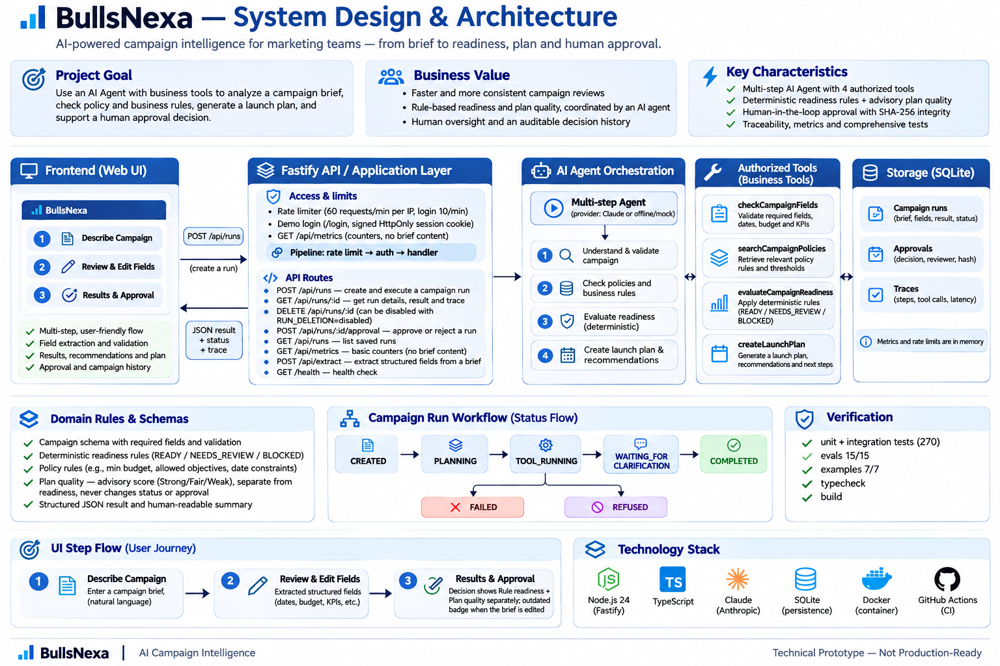

# BullsNexa — AI-Powered Campaign Intelligence

> BullsNexa is an independent technical-assignment prototype. It is not an official Bulls Vision Group product, and its rules and policy documents are **synthetic demonstration material**, not real business or legal guidance.

**Not in production today.** See [Real-world usage](#real-world-usage).

## In one minute



*Overview of components and data flow. Details, sequences and the threat model are in [docs/SYSTEM_DESIGN.md](docs/SYSTEM_DESIGN.md).*

| | |
| --- | --- |
| **What it is** | An agent that checks an advertising campaign brief before it launches and returns `READY`, `NEEDS_REVIEW` or `BLOCKED` with a 0–100 readiness score, the reasons, a launch plan and a full trace. A separate advisory **plan-quality** score shows how sensible the plan looks (KPI realism, budget pacing, timing). |
| **Who decides** | The model proposes the next step; deterministic backend code validates, authorizes, executes and decides. A person approves anything risky. |
| **Run it** | `npm ci && npm run build && npm start`, then open <http://127.0.0.1:3000> and press **Open the app**. Demo login: **`reviewer`** / **`demo-pass-1234`**. No API key needed: the default provider is offline. |
| **Verify it** | `npm test` (unit + integration), `npm run eval` (15 agent cases incl. injection and faults), `npm run examples` (sample briefs vs stored expected outputs). |
| **Stack** | Node + TypeScript (strict ESM), Fastify, Zod, `node:sqlite`, Vitest. No agent framework: a small custom orchestrator, justified in [Trade-offs](#trade-offs-and-decisions). |
| **Status** | Technical-assignment prototype on synthetic data. **Not in production today.** |

Deeper reading: [How it works](#how-it-works) · [Architecture](#architecture) · [docs/SYSTEM_DESIGN.md](docs/SYSTEM_DESIGN.md) (components, sequences, threat model, ADRs, design patterns).

## Problem statement

Campaign teams receive briefs that are incomplete, inconsistent or non-compliant: a missing objective, a budget that is negative or unusually high, an end date before the start date, a channel nobody supports, a lead campaign aimed at the EU without a privacy review. Catching this by hand before launch is slow and error-prone, and the cost of missing it is wasted spend or a policy breach.

BullsNexa turns a brief — structured or written in plain words — into a **checked, explainable launch-readiness decision** (`READY`, `NEEDS_REVIEW` or `BLOCKED`, with a 0–100 score), a launch plan when one is appropriate, and a full audit trail. When a person must decide, the system stops and asks.

## How it works

```text
free text (optional)                structured brief (JSON)
        |                                   ^
        v                                   |
POST /api/extract  --draft brief-->  person reviews / edits
 (one model tool call,                      |
  every field re-validated)                 v
                                     POST /api/runs
                                            |
                                            v
                 +-------------- bounded agent loop --------------+
                 |  model (Claude) or mock PROPOSES the next step |
                 |        |                                       |
                 |        v   backend validates, authorizes       |
                 |  checkCampaignFields  -> missing/invalid fields |
                 |  searchCampaignPolicies -> cited policy excerpts|
                 |  evaluateCampaignReadiness -> deterministic rules|
                 |  createLaunchPlan -> deterministic plan         |
                 |  ask_user | finish | refuse                     |
                 +-------------------------------------------------+
                                            |
                                            v
         decision + summary + trace  ->  SQLite history
                                            |
                 NEEDS_REVIEW? --yes--> human Approve / Reject
                                        (bound to a plan hash)
```

**The core rule: the model proposes, the backend decides.** Status, score, summary, clarification questions, launch plan and handoff state are computed by deterministic code from validated data. A model can choose *which step comes next*; it cannot set a result, skip evaluation, or change campaign data.

## Scope and non-scope

**In scope**
- One tool-using agent with explicit typed state and bounded execution (max steps, max tool calls, repeated-action detection, per-operation timeouts, one narrow retry).
- Deterministic, versioned readiness rules and a synthetic policy library the agent can search.
- Plain-text intake with human review before evaluation.
- Run history, observable traces, and a human approval step for non-trivial decisions.
- A minimal single-page UI and a small HTTP API.

**Out of scope (not implemented)**
- Publishing to any advertising platform, spending money, or any external side effect.
- Real authentication: individual user accounts, roles, multi-tenancy (only one shared demo login exists, see Access control).
- Real client data, real legal or compliance guidance, real company policies.
- Optimized budget allocation (the channel split is an equal-split placeholder).
- A multi-agent system (see [Trade-offs](#trade-offs-and-decisions)).

## Business cases

1. **Agency brief intake.** Account managers check client briefs before handing them to channel teams; incomplete briefs come back with specific questions instead of failing later.
2. **In-house launch gate.** A growth team applies the same budget, date, channel and privacy rules to every launch and keeps an auditable record of who approved exceptions.
3. **Regulated brand approvals.** High-budget or EU lead-generation campaigns are routed to a named reviewer, and an approval is tied to the exact plan that was reviewed.

## Quick start

Prerequisites: Node.js 24 (the project targets 24 LTS; see [verification status](#verification)) and npm.

```bash
npm ci
npm run build
AGENT_PROVIDER=simulated npm start      # offline, no API key needed
```

On Windows PowerShell:

```powershell
npm ci
npm run build
$env:AGENT_PROVIDER="simulated"
npm start
```

Open <http://127.0.0.1:3000> for the home page and press **Open the app** (or go straight to <http://127.0.0.1:3000/app>). Sign in with **`reviewer`** / **`demo-pass-1234`**. In the app, pick a sample brief (or describe a campaign in your own words and press **Extract fields**), press **Run agent**, inspect the verdict, score breakdown, launch plan and trace, and — for `NEEDS_REVIEW` runs — approve or reject. Recent runs are listed under the form.

### Evaluation checklist

| Reviewer check | Evidence | Run it |
| --- | --- | --- |
| Multi-step AI agent | Bounded planner loop with typed state and separate execution/business statuses | `npm run demo:agent` |
| Four business tools | Field check, policy search, readiness evaluation, launch-plan creation | `npm test -- tests/agent.test.ts tests/launch-plan.test.ts` |
| Structured JSON and readable summary | `/api/runs` contract plus the Step 3 decision center | `npm test -- tests/runs-api.test.ts` |
| Deterministic decisions | Versioned readiness rules remain authoritative; plan quality is advisory | `npm test -- tests/readiness.test.ts tests/plan-quality.test.ts` |
| Validation and guardrails | Zod schemas, tool authorization, ordering and execution limits | `npm test -- tests/domain-schemas.test.ts tests/agent.test.ts` |
| Retry, timeout and error handling | One classified transient retry, bounded operations, safe failures | `npm test -- tests/agent-reliability.test.ts` |
| Prompt-injection resistance | Untrusted-data delimiters plus deterministic backend enforcement | `npm run eval` |
| Logs, traces and usage | Correlated tool traces, latency/attempts and live-provider usage metadata | `npm run demo:agent` |
| Unit and integration tests | Domain, agent, HTTP, storage, security and approval coverage | `npm test` |
| Real-browser E2E | Five deterministic Chromium journeys using an isolated in-memory SQLite database | `npx playwright install chromium && npm run test:e2e` |
| Samples and expected outputs | Versioned briefs and checked expected results | `npm run examples` |

### Manual scenarios (about 3 minutes)

Start the app (`AGENT_PROVIDER=simulated npm start`), sign in, then paste each text into **Describe the campaign**, press **Extract fields**, review Step 2 and press **Run agent**. Results below were produced with the offline `simulated` provider; with live Claude the extracted wording may differ slightly, but the status and scores come from the deterministic rules.

| # | Input | Expected result |
| --- | --- | --- |
| 1 | `Called "Winter Coats Sale". Objective: sales. Audience: adults 25-45 who buy winter clothing online. Budget 15k EUR on Instagram and Google in Germany, 2027-01-05 to 2027-02-04, aim for 400 purchases. Category: fashion.` | `READY`, rule readiness 100, plan quality 100 (Strong) |
| 2 | `Called "Flash Sneaker Drop". Objective: sales. Audience: sneaker fans in Germany. Budget 500 EUR on Instagram in Germany, 2027-03-01 to 2027-03-03, aim for 900 purchases. Category: fashion.` | `READY`, rule readiness 100, plan quality 60 (Weak): passes the required checks, but the plan needs attention |
| 3 | Pick the sample **High budget** | `NEEDS_REVIEW` with a human Approve / Reject step |
| 4 | In Step 2, set the budget to `-500` and press **Run agent** | `BLOCKED`, no launch plan, no approval possible |
| 5 | Pick the sample **Prompt injection** | The injected text changes nothing: same decision as the **Complete brief** sample |
| 6 | After any run, edit the budget field | The result is marked outdated until **Run agent** is pressed again; an earlier approval does not carry over |

More cases (extraction edge cases, every status, approval) are in [docs/TEST_SCENARIOS.md](docs/TEST_SCENARIOS.md).

All commands except the explicitly named live smoke commands use offline providers and require no Anthropic credentials. The browser suite starts its own simulated-provider server with isolated in-memory storage and never loads `.env`.

### Provider modes

`AGENT_PROVIDER` selects who proposes the next step. Business rules are identical in every mode.

| Mode | What it is | Needs |
| --- | --- | --- |
| `mock` (default) | Deterministic rule-based provider. Not an LLM. | nothing |
| `simulated` | Offline stand-in that speaks the real Anthropic `tool_use` protocol, including matching tool-call ids. Rule-based, **not an LLM**; results are labeled `simulated-claude`. | nothing |
| `anthropic` | Live Claude through the Messages API with tool calling. No silent fallback: missing configuration is a clear 503/startup error. | `ANTHROPIC_API_KEY`, `ANTHROPIC_MODEL` |

Copy `.env.example` to `.env` for the live mode. The key is never logged, returned, or sent to the model.

The app asks for a sign-in. The demo login is **`reviewer`** / **`demo-pass-1234`**; change it with `AUTH_USERNAME` and `AUTH_PASSWORD`, or set `AUTH=disabled` to switch the sign-in off — see [Access control and limits](#access-control-and-limits).

### Docker

```bash
docker build -t bulls-nexa .
docker run --rm -p 3000:3000 -v bullsnexa-data:/app/var bulls-nexa
curl http://127.0.0.1:3000/health
```

**Docker has not been built or run by the author** (no Docker in the authoring environment); only a static test guards the Dockerfile. The image is multi-stage, runs as the non-root `node` user, and writes SQLite to `/app/var`.

## Example inputs and expected outputs

Sample briefs live in [`examples/briefs`](./examples/briefs) with expected outputs in [`examples/expected`](./examples/expected). `npm run examples` re-runs all of them (with a fixed evaluation date, so the outputs do not drift) and fails on any difference. The expected values agree with the independent expectations in `evals/campaign-cases.json`, and the test suite asserts the key outcomes by hand rather than trusting the stored files alone.

| Sample | Expected result |
| --- | --- |
| `01-ready-campaign` | `READY`, score 100, handoff `CLEARED`, launch plan available |
| `02-high-budget-needs-review` | `NEEDS_REVIEW`, 100, risk `HIGH_BUDGET_REVIEW`, handoff `PENDING_APPROVAL` |
| `03-eu-leads-privacy-review` | `NEEDS_REVIEW`, 97, risk `EU_LEADS_PRIVACY_REVIEW` |
| `04-blocked-negative-budget` | `BLOCKED`, 80, risk `INVALID_BUDGET`, handoff `NOT_ELIGIBLE`, no plan |
| `05-incomplete-needs-clarification` | `WAITING_FOR_CLARIFICATION`, no score; asks for objective, country, budget, currency, dates, KPI |
| `06-prompt-injection-in-notes` | injection in `additionalNotes` ignored; `NEEDS_REVIEW` (not `READY`) |
| `free-text/summer-sandals.txt` | extracted into a draft brief, then `READY`, 100 |

Run one yourself (server running, `curl` on bash; PowerShell users can use the UI or `Invoke-RestMethod`):

```bash
curl -s -X POST http://127.0.0.1:3000/api/runs \
  -H 'content-type: application/json' \
  -d "{\"brief\": $(cat examples/briefs/02-high-budget-needs-review.json)}"
```

The API sits behind the demo sign-in. For `curl`, either start the server with `AUTH=disabled`, or sign in first and reuse the cookie:

```bash
curl -s -c cookies.txt -H 'content-type: application/json' \
  -d '{"username":"reviewer","password":"demo-pass-1234"}' http://127.0.0.1:3000/api/login
curl -s -b cookies.txt -X POST http://127.0.0.1:3000/api/runs \
  -H 'content-type: application/json' \
  -d "{\"brief\": $(cat examples/briefs/02-high-budget-needs-review.json)}"
```

Abridged real response (`AGENT_PROVIDER=mock`; the full response also carries the whole brief-derived decision, issues, plan checklist, run id and trace ids):

```json
{
  "executionStatus": "COMPLETED",
  "businessStatus": "NEEDS_REVIEW",
  "summary": "Campaign NEEDS_REVIEW: The valid budget exceeds the synthetic human-review threshold.",
  "decision": {
    "score": 100,
    "scoreBreakdown": {
      "completeness": { "score": 40, "maximum": 40 },
      "budget": { "score": 20, "maximum": 20 },
      "policyCompliance": { "score": 25, "maximum": 25 },
      "measurableObjective": { "score": 15, "maximum": 15 },
      "total": 100
    },
    "risks": [{ "code": "HIGH_BUDGET_REVIEW", "level": "MEDIUM", "policyRef": "BUDGET_POLICY_V1" }],
    "requiresHumanReview": true,
    "rulesVersion": "1.0.0"
  },
  "handoff": { "status": "PENDING_APPROVAL", "approvalRequired": true },
  "launchPlan": {
    "schedule": { "startDate": "2027-01-10", "endDate": "2027-02-10", "durationDays": 32 },
    "budget": {
      "total": 150000,
      "dailyBudget": 4687.5,
      "channels": [
        { "channel": "search", "amount": 75000, "sharePercent": 50 },
        { "channel": "social", "amount": 75000, "sharePercent": 50 }
      ]
    }
  },
  "provider": { "mode": "mock" },
  "persisted": true
}
```

The response also lists the trace: `AGENT_STARTED`, then for each tool `ACTION_PROPOSED` → `TOOL_STARTED` → `TOOL_SUCCEEDED` (with `durationMs` and `attempt`), and finally `AGENT_COMPLETED`.

### Readiness score vs plan quality

The **readiness score** (0–100) answers *"may this launch?"*: it measures whether the brief is complete, valid and policy-compliant, so every sound brief scores 100 and the status does the deciding. On its own it cannot tell a sound plan from an unrealistic one.

So each run that is not `BLOCKED` also gets an advisory **plan-quality** score (`planQuality` in the response, a "Plan quality" card in the UI). It starts at 100 and deducts points for: a KPI target outside a synthetic cost-per-result range (−25 or −10), a thin daily budget (−20 or −10), a flight shorter than 7 or longer than 92 days (−10 or −5), a start within 3 or 7 days (−15 or −8), a single channel (−5), and a vague audience (−5). It is a pure, deterministic function (`src/domain/plan-quality.ts`) and **never changes the status, readiness score or approval**. Example: two `READY` briefs, both 100 for readiness — 500 purchases on 25,000 USD scores 100 for plan quality, 20,000 purchases on the same budget scores 75 ("KPI target looks ambitious"). Rules: [docs/rubric.md](docs/rubric.md#plan-quality-advisory).

> The sample dates are in 2027. A start date in the past is itself a review trigger, so after those dates pass, live runs of the samples will change; `npm run examples` is unaffected because it uses a fixed date.

## System Design

For a detailed technical overview of BullsNexa's architecture,
agent orchestration, security, data flows, and design decisions,
see [System Design](docs/SYSTEM_DESIGN.md).

## Architecture

| Area | Path | Responsibility |
| --- | --- | --- |
| Domain | `src/domain` | Zod contracts, versioned rules, pure `evaluateReadiness`, pure `createLaunchPlan`. No network, clock, randomness or model. |
| Agent | `src/agent` | Orchestrator loop, tool registry, providers (mock, Anthropic, simulated), policy search, reliability (timeouts, retry), free-text extraction. |
| Approval | `src/approval` | Handoff rule and plan-hash approval integrity. |
| Persistence | `src/persistence` | SQLite (Node's built-in `node:sqlite`): runs, trace events, approvals. |
| HTTP | `src/routes`, `src/app.ts` | Fastify routes, validation, safe error envelope, request ids. |
| UI | `public/*.html`, `public/js` | Framework-free HTML/CSS plus focused ES modules for API access, validation, stateful workflow and decision presentation; text-only DOM writes and strict same-origin CSP. |
| Evaluation | `src/eval`, `evals`, `examples` | 15-case agent evaluation, fault injection, sample inputs/outputs. |

### Agent design

- **State.** Typed `AgentState` holds the trusted brief, evaluation date, tool results and trace. The model never receives a way to alter it: tool arguments are strict empty schemas (the policy search takes only a short query string), so budgets, dates and campaign data cannot be supplied by the model.
- **Planning.** At each step the provider proposes exactly one action (`CALL_TOOL`, `ASK_USER`, `FINISH`, `REFUSE`). The orchestrator validates it against a strict schema, checks the tool exists and is authorized, runs it with a timeout, and feeds the real result back.
- **Statuses are separate.** Technical execution (`COMPLETED`, `WAITING_FOR_CLARIFICATION`, `FAILED`, `REFUSED`, …) is distinct from the business decision (`READY`, `NEEDS_REVIEW`, `BLOCKED`). A failed run never yields a made-up decision.
- **Ordering rules enforced by code.** `FINISH` is accepted only after a successful evaluation; the launch plan needs an evaluation first; a blocker still goes through evaluation so it is recorded; clarification questions come from the trusted field check, not from the model.
- **Tools.** Four business tools (`checkCampaignFields`, `searchCampaignPolicies`, `evaluateCampaignReadiness`, `createLaunchPlan`) and three control actions (`ask_user`, `finish`, `refuse`). Control actions do not count against the business tool limit (default 4).

### Trust boundaries (prompt hygiene)

- The brief, free text, tool results and policy excerpts are **untrusted data**. They are sent to the model as bounded, escaped JSON between delimiters, never inside instructions, and the system prompt tells the model to ignore instructions found in them.
- Even if a model obeys an injection, the backend still computes every result. This is tested: with an obedient scripted model, injected text cannot change status, skip evaluation, force `FINISH`, or smuggle fields through extraction.
- Policy search reads only the five configured policy files from a root derived from the module location (not the working directory); the model controls only a bounded query string.
- Logs contain identifiers, statuses and timings, never the brief; secrets are redacted.

### Reliability

| Concern | Behavior |
| --- | --- |
| Timeouts | Per operation; 5 s default, 25 s for the live provider, 20 s for extraction. `AbortSignal` is propagated. A late result cannot change a finished run. |
| Retries | One, only for explicitly transient failures (rate limit, connection, 5xx) on retry-safe providers or idempotent tools. Auth and invalid-request errors are never retried. SDK retries are disabled so counts do not multiply. |
| Limits | Maximum planning steps and tool calls, repeated-action protection. |
| Bad model output | Text without a tool call, extra or wrong fields, unknown or unauthorized tools, multiple tool calls: controlled failure, no decision. |
| Storage failure | The decision is still returned, flagged `persisted: false`. |
| Cost | `max_tokens` 512 (agent) / 700 (extraction); actual token usage from the API is summed per run and never estimated. Offline modes report none. |

## Approval and observability

- Every run is stored: brief, decision, per-step trace with latency and attempt number, token usage (live mode only), total duration. `GET /api/runs` and `GET /api/runs/:id` expose them.
- Handoff is a deterministic rule: `BLOCKED` → `NOT_ELIGIBLE` (cannot be approved); `NEEDS_REVIEW` or evaluator-flagged → `PENDING_APPROVAL`; otherwise `CLEARED`.
- An approval must carry the SHA-256 `planHash` of the brief, decision and launch plan the reviewer saw. A stale hash is rejected, a second decision is rejected, and an approval stops counting (`APPROVAL_INVALIDATED`) if the stored plan no longer matches.
- **The shared demo sign-in is not reviewer identity.** It gates access to the prototype, but the approval reviewer name remains a free-text audit label and is not an authenticated user identity.

## API

| Method and path | Purpose |
| --- | --- |
| `GET /` | Home page. |
| `GET /app` | The working tool (single-page UI). |
| `GET /health` | Liveness. |
| `GET /api/config` | Provider mode, the evaluation date in use, and two UI switches. |
| `POST /api/extract` `{ text }` | Free text → draft brief, field lists, notice to review. |
| `POST /api/runs` `{ brief }` | Run the agent; returns decision, summary, trace, handoff, launch plan, plan hash. |
| `GET /api/runs` | Last 20 runs. |
| `GET /api/runs/:id` | One run with trace, plan and approval. |
| `POST /api/runs/:id/approval` | `{ decision, reviewer, comment?, planHash }`. |
| `DELETE /api/runs/:id` | Remove a run with its trace and approval (204, 404, or 403 when `RUN_DELETION=disabled`). |
| `GET /api/metrics` | Request counts per route template and status, and aggregate run counts. No brief content. |
| `POST /api/login`, `POST /api/logout` | Only when a demo login is configured; sets or clears the session cookie. |
| `GET /login` | Sign-in page (only reachable as a page; it is always served). |
| `GET /images/:name` | Decorative photos from a fixed allowlist (same-origin). |

Errors share one envelope, `{ "error": { "code", "message" }, "requestId" }`, with 400 (invalid input), 401 (not signed in / wrong credentials), 403 (deletion disabled), 404, 409 (approval conflicts), 413 (body too large), 429 (rate limited, with `Retry-After`), 503 (live provider not configured) and 504/502 (extraction timeout/provider error). Body limits: 32 KB runs, 16 KB extract, 4 KB approval.

## Configuration

| Variable | Default | Meaning |
| --- | --- | --- |
| `AGENT_PROVIDER` | `mock` | `mock`, `simulated` or `anthropic`. |
| `ANTHROPIC_API_KEY`, `ANTHROPIC_MODEL` | – | Required only for `anthropic`. `.env.example` suggests `claude-haiku-5-5`. |
| `DATABASE_PATH` | `var/bullsnexa.sqlite` | SQLite file (git-ignored). |
| `HOST`, `PORT` | `127.0.0.1`, `3000` | Listen address. |
| `AUTH_USERNAME`, `AUTH_PASSWORD` | `reviewer`, `demo-pass-1234` | Sign-in for `/app` and the API. The defaults are public demo credentials; override them on a deployment. |
| `AUTH` | `enabled` | `disabled` turns the sign-in off. |
| `SESSION_SECRET` | random per process | Optional; keeps sessions valid across restarts. |
| `RATE_LIMIT_MAX`, `RATE_LIMIT_WINDOW_MS` | `60`, `60000` | Per-client limit on `POST`/`DELETE` under `/api`. `0` disables it. |
| `RUN_DELETION` | `enabled` | `disabled` makes `DELETE /api/runs/:id` answer 403 and hides the control in the UI. |
| `TRUST_PROXY` | `false` | Set to `true` only behind a reverse proxy you control (client IP and `Secure` cookies). |

### Access control and limits

The prototype has no user accounts. It uses **one shared login**, on by default (`reviewer` / `demo-pass-1234`, public on purpose so reviewers can get in):

- Without a session, `/app` redirects to `/login` and every `/api` route except `/api/login` answers 401.
- The session is a signed, expiring cookie (HMAC-SHA256, 8 hours, `HttpOnly`, `SameSite=Strict`, `Secure` over HTTPS). Credentials are compared in constant time, and sign-in attempts are limited to 10 per minute per client.
- The home page, `/login`, `/health`, the favicon and the decorative images stay public.
- `POST`/`DELETE` under `/api` are limited to 60 requests per minute per client (fixed window, in memory, per process) and answer 429 with `Retry-After`.
- `GET /api/metrics` exposes operational counters only: method, route **template**, status code, and aggregate run counts. It never returns a brief, trace or approval.

This is a demo access gate, **not** production authentication: the default password is published here, the server logs a warning while it is in use, and there is one shared account, no roles, no password reset, no account lockout, and the limiter is per process rather than shared across instances. Real deployment still needs identity, RBAC, tenant isolation and an immutable audit log — see [Limitations](#limitations).

## Verification

```bash
npm run typecheck     # strict TypeScript
npm test              # unit and HTTP integration tests (offline)
npm run test:e2e      # five real-browser Chromium journeys (offline)
npm run build
npm run eval          # 15 evaluation cases through the real agent, offline
npm run examples      # sample inputs vs expected outputs
npm run demo:agent    # printed traces: mock, simulated Claude, failure, injection
```

The Phase 6 runner invokes the agent for all 15 dataset cases. Cases 01–08 are deterministic business workflows, cases 09–14 exercise dedicated fault and security scenarios, and case 15 combines agent execution with approval-integrity checks. The `executionScope` and `expectedOutcome` values for cases 09–15 remain historical Phase 1 metadata, when those cases were deferred; they do not describe their current Phase 6 execution status. Not all 15 cases are complete HTTP end-to-end tests—the separate end-to-end test covers free-text extraction, agent execution, approval, and history through the HTTP API.

All tests are offline and deterministic (explicit dates, scripted or simulated providers). What they cover: domain rules and score boundaries; the agent loop, strict action validation, authorization, limits, timeouts, cancellation, retries and late-result isolation; the Anthropic tool-use protocol with a scripted client (matching tool-call ids, retries, malformed responses, token accounting); policy retrieval independent of the working directory; free-text extraction; persistence and approval integrity; the HTTP API; the 15-case evaluation (prompt injection in the brief and in policy text, missing policy sources, tool timeout, malformed model output, unauthorized tool, plan changed after approval); an end-to-end flow from free text to approval; and a static check of the Dockerfile.

### Verification status

| Item | Status |
| --- | --- |
| Current verification | Typecheck passed; 21 Vitest files / 270 tests passed; 5/5 Playwright Chromium journeys passed; `eval` 15/15, `examples` 7/7, production build and dependency audit passed locally on Windows. Node 25.6.1 is outside the declared `>=24 <25` engine range. |
| Earlier verification on Node 22.23.4 (Linux) | 17 files / 213 tests, `eval` 15/15, and all examples passed before the final reliability fixes. |
| Node 24 LTS (the stated target) | **Not verified.** |
| Live Claude, one smoke run (`AGENT_PROVIDER=anthropic`, `npm run smoke:agent`, 2026-11-12, author's Windows machine) | **PASS.** One run on the sample complete brief: `COMPLETED`, `READY`, score 100, tools `checkCampaignFields` then `evaluateCampaignReadiness`, 3 provider requests, 6199 input / 55 output tokens. This is a single run, not a quality or robustness evaluation; behavior on other briefs, on injection attempts and on live free-text extraction is covered only by the scripted-protocol tests. |
| Extraction quality on messy real text | **Not verified.** Tests use a rule-based simulator and scripted responses. |
| Docker build and run | **Not verified locally:** Docker is not installed in the authoring environment. CI defines a real image-build job, but that workflow has not run yet. |
| Browser E2E | **PASS locally:** 5/5 deterministic journeys in Playwright Chromium. Firefox, WebKit and broad device coverage are not included. |
| GitHub Actions CI | **Not verified:** the workflow is defined but has not run on GitHub. |

Current counts: 21 Vitest files / 270 tests plus 5 Playwright Chromium journeys (`npm run test:e2e`); `npm run eval` 15/15; `npm run examples` 7/7. Node 24 and GitHub-hosted CI remain unverified.

To check live behavior yourself: put a key and model in `.env`, set `AGENT_PROVIDER=anthropic`, run `npm run smoke:agent` (one short run; prints status, tools and token usage only, never the key).

## Trade-offs and decisions

- **One agent, not a multi-agent system.** The task is a short, safety-critical pipeline where deterministic code must stay authoritative. Splitting it across agents would add coordination failure modes without adding capability. The tool registry, typed state and provider interface are the seams where further agents could be added (for example a separate review-summarizer), but nothing here pretends to be multi-agent.
- **No agent framework.** A small bounded loop is easier to test, bound and explain than a graph runtime for four tools; the provider interface keeps the model swappable.
- **LLM at the edges only.** Claude chooses the next step and (optionally) drafts a brief from text. It never produces the decision. This costs flexibility and buys auditability.
- **Human review of extraction.** Misreading free text is the highest-risk model step, so a person confirms the draft before anything is evaluated, and the evaluator re-checks every field.
- **`node:sqlite` instead of a native package.** No build toolchain or prebuilt-binary risk; the cost is that the module is still marked experimental and prints a warning.
- **Simulated providers.** They make the whole product demoable and testable offline, and are labeled everywhere so they cannot be mistaken for a model.
- **Equal-split budget placeholder.** An optimized split would be an unverified claim, so the plan says plainly that it is a placeholder.
- **Synthetic rules.** Thresholds and policies are demonstration values in versioned config, not business advice.

## Limitations

- Live Claude was verified with one smoke run only; Docker and Node 24 are unverified (see above).
- One optional shared demo login only: no user accounts, roles, tenant isolation or account lockout, and approvals are not audit-grade (a reviewer name is a label).
- The country check validates the alpha-2 format only; it does not ship a full country registry.
- The offline extractor understands simple English and ISO dates only, over a fixed list of countries and categories; the live mode handles free phrasing far better.
- No overall run deadline; an operation that ignores `AbortSignal` is abandoned, not physically stopped.
- SQLite data is local to the process or volume; there is no migration tooling, retention policy or backup.
- The rate limiter is a fixed window held in memory per process, so it does not hold across several instances or a restart.
- `/api/metrics` is counters only: no histograms, percentiles, spans or export to a monitoring system.
- The launch plan is a synthetic hand-off document; nothing is sent to any platform.
- Plan-quality benchmarks are synthetic demonstration ranges, identical across currencies and industries; they are advice, not market data.

## Next steps

1. Run the evaluation cases and live free-text extraction against real Claude and measure token cost and latency across them (only one smoke run exists so far).
2. Authentication, roles and per-user approval authority.
3. Evaluate extraction on real, messy briefs, including non-English text.
4. Exportable reports and a change-and-resubmit flow for corrected briefs.
5. Metrics and alerting around run outcomes, latency and token usage.
6. A managed database, migrations and a retention policy.
7. Confirm the Docker image and the GitHub Actions workflow on their first real runs, and test on Node 24 (the declared target).
8. Split `public/js/app.js` further as the UI grows, and extend the browser tests beyond Chromium.

## Real-world usage

**Not in production today.** BullsNexa has not been used with any business or real client data.

Realistic users:
- **A marketing or performance agency** checking client briefs before channel handoff.
- **An in-house growth team** standardizing launch gates and keeping an approval record.
- **A regulated brand** (finance, health, EU-facing lead generation) that needs documented review of high-risk campaigns.

What productionizing would require:
- **Security:** authentication, authorization and tenant isolation; secret management; rate limiting; dependency and prompt-injection review against real data.
- **Data access:** real campaign and policy sources with access control instead of synthetic files, and a decision on what may be sent to a model provider.
- **Monitoring:** metrics, alerting and cost tracking on top of the existing traces; model and rules evaluation on an ongoing basis.
- **Human-in-the-loop:** verified reviewer identity, escalation paths and an immutable audit log.
- **Compliance:** legal review of the real policies encoded as rules, data retention and privacy obligations, and sign-off before any automated action reaches an ad platform.

## Repository layout

```text
src/domain        rules, schemas, evaluator, launch plan, plan quality
src/agent         orchestrator, tools, providers, extraction, policy search
src/approval      handoff and plan-hash integrity
src/persistence   SQLite run store
src/routes        HTTP routes
src/http          login sessions, rate limiter, request counters
src/eval          15-case agent evaluation
src/examples      example runner
public            HTML pages plus framework-free browser modules under public/js
tests/e2e         Playwright browser journeys with isolated temporary storage
.github/workflows offline CI quality, browser, Docker and dependency-audit jobs
data/synthetic-policies   five synthetic policy documents
evals             evaluation dataset
examples          sample inputs and expected outputs
tests             all tests (offline)
docs/SYSTEM_DESIGN.md     components, sequences, threat model, ADRs, design patterns
docs/rubric.md    exact scoring rubric
ENGINEERING_LOG.md   phase-by-phase record of decisions and verification
```

See [ENGINEERING_LOG.md](./ENGINEERING_LOG.md) for the chronological build record and [docs/rubric.md](./docs/rubric.md) for the scoring rules. The log is historical: statements in earlier phases describe the project at that time.
