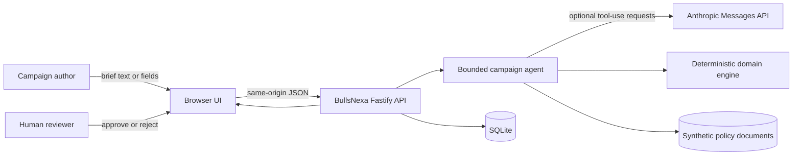
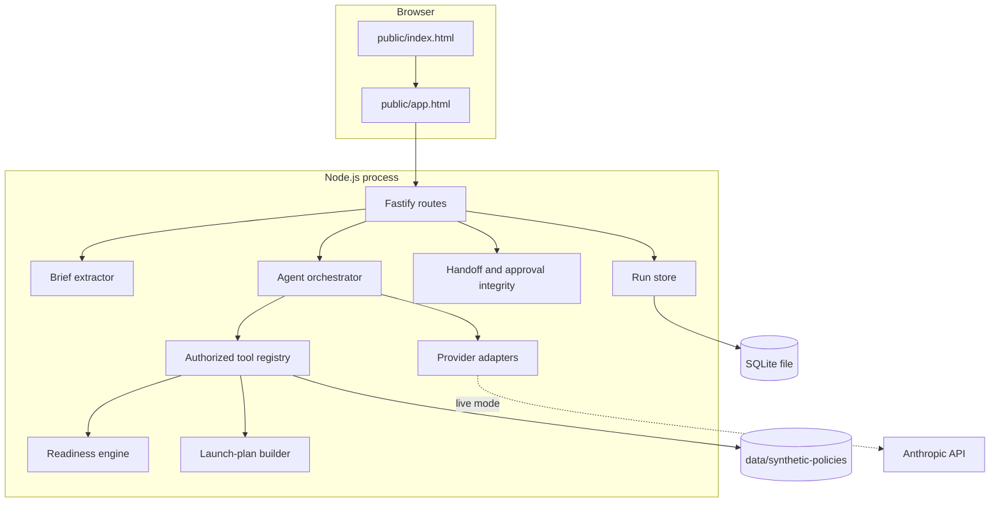
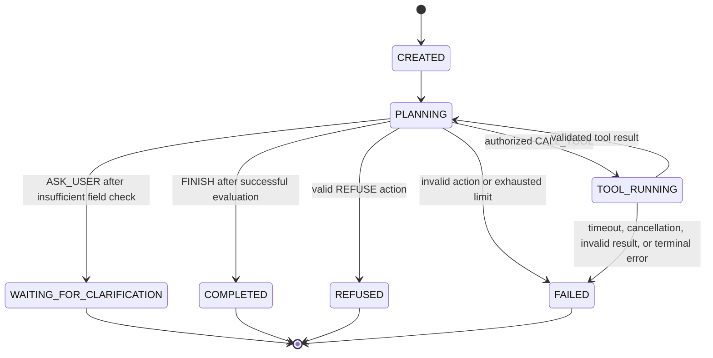
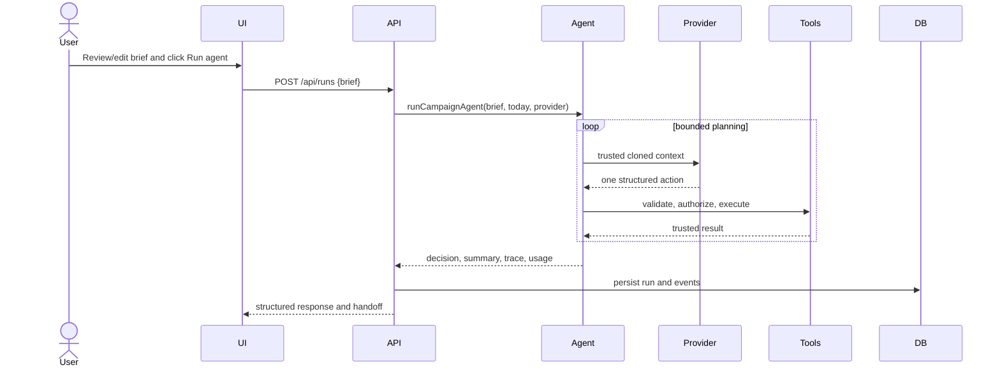
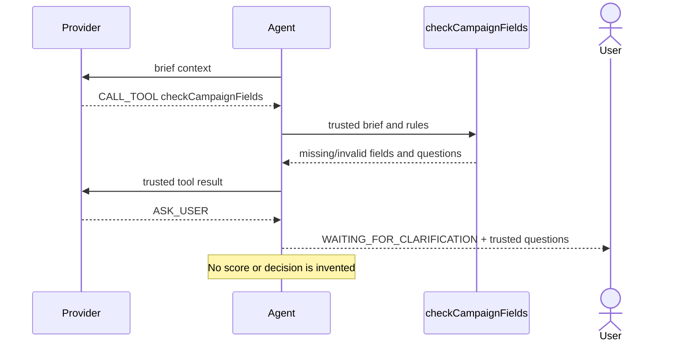
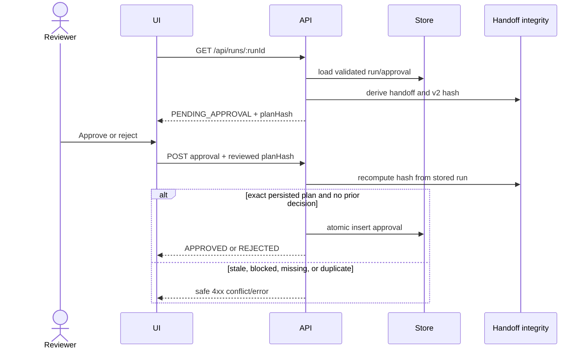
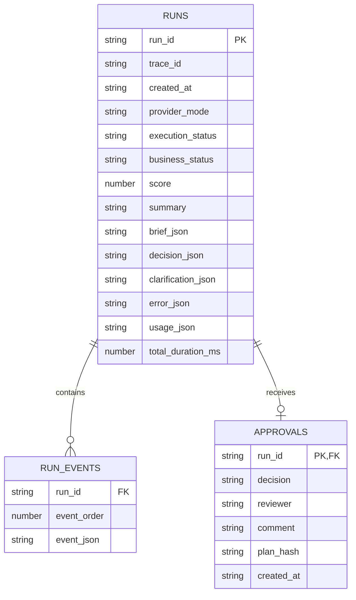
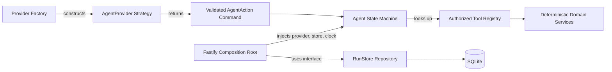

# BullsNexa System Design

> **Status:** Implemented technical-assignment prototype. **Not in production today.**

This document is the deep technical reference for BullsNexa. It describes the
code that exists in this repository, its trust boundaries, and the trade-offs
behind it. The [README](../README.md) remains the concise entry point for setup,
examples, and current verification results.

## 1. Executive System Overview

BullsNexa converts a structured or natural-language campaign brief into an
explainable launch-readiness result. A bounded agent may use a model to propose
the next step, but deterministic backend code owns validation, scoring,
business status, launch planning, persistence, and approval eligibility.

The central invariant is:

> The model proposes actions; trusted application code validates, authorizes,
> executes, and decides.

The delivered system contains:

- a Fastify HTTP API and same-origin browser UI;
- a custom, provider-neutral agent orchestrator;
- mock, simulated Anthropic-protocol, and real Anthropic providers;
- four authorized business tools;
- strict Zod contracts at provider, tool, API, domain, and persistence boundaries;
- a deterministic readiness engine and deterministic launch-plan builder;
- bounded retrieval over five synthetic policy documents;
- SQLite run history, traces, and one-decision-per-run approvals;
- offline evaluations, fault injection, API integration tests, and examples.

It does **not** publish advertisements, spend money, authenticate users, provide
legal advice, or implement a production multi-tenant platform.

## 2. Business Problem and Scope

Campaign briefs commonly arrive incomplete or inconsistent. Missing budgets,
unsupported channels, incompatible KPIs, impossible dates, and review-triggering
conditions can otherwise be discovered only after work has begun.

BullsNexa addresses this by producing one of three business statuses:

| Status | Meaning | Handoff implication |
| --- | --- | --- |
| `READY` | The validated brief meets the synthetic readiness rules. | `CLEARED` unless a separate review flag exists. |
| `NEEDS_REVIEW` | The brief can be evaluated, but a configured rule requires a person. | `PENDING_APPROVAL`. |
| `BLOCKED` | A hard rule prevents launch planning or approval. | `NOT_ELIGIBLE`. |

Technical execution status is separate from business status. A timeout,
malformed provider response, or unauthorized tool request produces `FAILED`,
not a fabricated campaign decision.

## 3. Functional and Non-Functional Requirements

### Functional requirements

- Accept structured campaign briefs through `POST /api/runs`.
- Optionally extract a draft from free text through `POST /api/extract`.
- Ask for clarification rather than guessing missing or ambiguous fields.
- Search bounded synthetic policy material with source references.
- Produce a structured decision, readable summary, trace, and optional launch plan.
- Persist runs and expose recent history and details.
- Require and record a human decision for reviewable campaigns.
- Reject approval of blocked, stale, malformed, or unpersisted runs.

### Non-functional requirements

- Deterministic business rules and reproducible offline tests.
- Strict runtime validation of all untrusted boundaries.
- Bounded provider steps, tool calls, retries, payloads, and operation time.
- No silent fallback from live Anthropic mode to an offline provider.
- No secret, brief, or full request-body logging by default.
- Compiled ESM output that runs directly under Node.js.

## 4. Actors and External Dependencies

| Actor or dependency | Role | Trust level |
| --- | --- | --- |
| Campaign author | Supplies free text or edits a structured brief. | Untrusted input. |
| Reviewer | Approves or rejects a persisted `NEEDS_REVIEW` run. | Human action, but identity is only a label. |
| Browser UI | Same-origin client for extraction, execution, history, and approval. | Presentation boundary. |
| Anthropic Messages API | Optional action planner and optional brief extractor. | Probabilistic, untrusted output. |
| Synthetic policy files | Retrieval evidence for the agent and reviewer. | Data, never executable instructions. |
| SQLite | Local persistence for runs, trace events, and approvals. | Validated again when deserialized. |

Runtime dependencies are deliberately small: Fastify, Zod, Pino, and the
official Anthropic SDK. Node's built-in `node:sqlite` provides persistence.

## 5. System Context Diagram

Anthropic is optional. Mock and simulated modes keep the application and all
automated verification offline.

## 6. Container / High-Level Architecture Diagram

The Docker image packages compiled `dist/`, `public/`, and `data/`. SQLite is
written under `/app/var` by the non-root `node` user.

## 7. Component Responsibilities and Module Mapping

| Component | Primary modules | Responsibility |
| --- | --- | --- |
| HTTP application | `src/app.ts`, `src/server.ts` | App construction, logging, safe errors, startup, shutdown. |
| Routes | `src/routes/runs.ts`, `records.ts`, `health.ts` | Request validation, extraction/run endpoints, history, approvals, static UI. |
| Agent core | `src/agent/orchestrator.ts`, `contracts.ts` | State machine, action validation, authorization, limits, traces. |
| Providers | `anthropic-provider.ts`, `mock-provider.ts`, `simulated-claude.ts`, `provider-factory.ts` | Propose the next validated action and report usage. |
| Extraction | `brief-extraction.ts`, `simulated-extractor.ts` | Free text to a reviewable partial brief; never starts the agent. |
| Tools and retrieval | `tools.ts`, `policy-search.ts` | Trusted tool registry and bounded policy search. |
| Domain | `src/domain/*` | Schemas, rules, readiness decisions, dataset contracts, launch plans. |
| Approval | `src/approval/handoff.ts` | Handoff states, v2 plan hash, approval validation. |
| Persistence | `src/persistence/run-store.ts` | SQLite schema, validated serialization, atomic approval insertion. |
| Evaluation | `src/eval/*`, `evals/` | Fifteen-case agent evaluation and fault injection. |
| Examples | `src/examples/*`, `examples/` | Reproducible sample runs and stored expected outputs. |

## 8. Agent Orchestration Architecture

`runCampaignAgent()` implements a small custom loop rather than using a general
agent framework. Each iteration asks the selected provider for exactly one
action, validates it, enforces preconditions, optionally executes one tool, and
feeds the resulting trusted state into the next iteration.

Defaults are six planning steps, four business-tool calls, five seconds per
ordinary provider/tool operation, and one retry for explicitly transient,
retry-safe operations. The real Anthropic provider declares a 25-second
provider timeout.

### Why a custom orchestrator

The workflow is short, highly constrained, and safety-sensitive. A compact loop
makes action schemas, tool authorization, terminal conditions, retries, and
state transitions directly inspectable and testable. A graph or multi-agent
framework would add coordination and dependency surface without improving the
four-tool use case. The provider interface remains the extension seam if the
planning implementation changes later.

## 9. Agent State and Action Contracts

`AgentStateSchema` stores correlation IDs, technical status, step count, the
trusted brief, explicit evaluation date, tool results, trace history,
clarification questions, and an optional final decision/error.

Provider actions are a strict discriminated union:

| Action | Provider-controlled data | Backend enforcement |
| --- | --- | --- |
| `CALL_TOOL` | Tool name and schema-bound arguments. | Registry lookup, authorization, preconditions, limits, strict argument parse. |
| `ASK_USER` | Control intent only. | Questions come from the trusted field inspection, not model prose. |
| `FINISH` | No status or score. | Requires a successful `evaluateCampaignReadiness` result. |
| `REFUSE` | One fixed refusal code. | Strict enum mapped to a safe backend result. |

The provider receives a structured clone of context. Tools also receive cloned
state and configuration. Late or malicious mutation therefore cannot rewrite
the authoritative state held by the orchestrator.

## 10. Anthropic Tool-Calling Protocol

`AnthropicProvider` uses the real Messages API in live mode. It exposes the
authorized business tools plus three control tools: `ask_user`, `finish`, and
`refuse`.

- `tool_choice` is `any`; parallel tool use is disabled.
- `max_tokens` defaults to 512.
- SDK retries are set to zero; the orchestrator owns the bounded retry policy.
- Each response must contain exactly one usable `tool_use` action.
- Tool arguments are validated with Zod before becoming an `AgentAction`.
- Business tool results are returned with the matching `tool_use_id`.
- Transcript updates are committed only after a successful provider response.
- Input context and tool results are bounded by string, array, object, depth,
  and serialized-payload limits.
- API errors are classified and sanitized before reaching agent results.
- Per-response token usage is aggregated across the run.

There is no hidden fallback to `MockProvider`. Missing live configuration is a
sanitized configuration error.

## 11. Authorized Business Tools

| Tool | Arguments | Trusted behavior |
| --- | --- | --- |
| `checkCampaignFields` | Strict empty object. | Calls `inspectCampaignBrief`; returns Phase 1 issue codes, severities, missing/invalid fields, and trusted clarification questions. It does not score or assign status. |
| `searchCampaignPolicies` | Bounded query and optional result limit. | Searches only the configured five policy files and returns cited excerpts. |
| `evaluateCampaignReadiness` | Strict empty object. | Calls the authoritative deterministic evaluator using the brief/date/config from state. |
| `createLaunchPlan` | Strict empty object. | Builds a deterministic plan only after a successful evaluation; blocked or invalid briefs receive no plan. |

The model cannot pass a replacement budget, objective, dates, rules, score, or
status through these schemas. Unknown and registered-but-unauthorized tools are
rejected before execution.

## 12. Natural-Language Brief Extraction

Extraction is a separate intake operation, not an agent step:

1. The API validates a trimmed input of 3–4000 characters.
2. The extractor wraps text as delimited untrusted data.
3. Claude is forced to call only `submit_campaign_brief` with parallel calls disabled.
4. Missing, multiple, malformed, or unknown tool arguments fail safely.
5. Every returned field is revalidated against `PartialCampaignBriefSchema`.
6. Invalid fields are omitted and reported through `droppedFields`.
7. The UI displays an editable draft and requires a separate **Run agent** action.

The extraction request has a 20-second timeout, `max_tokens` 700, zero SDK
retries, and early handling for an already-aborted signal. It does not infer a
year for ambiguous dates and does not fabricate missing values.

## 13. Campaign Readiness Decision Engine

`evaluateReadiness()` is a pure function over `brief`, versioned rules, and an
explicit `today`. It has no model, network, database, filesystem, random, or
implicit clock dependency.

The 100-point rubric is:

| Criterion | Maximum |
| --- | ---: |
| Completeness | 40 |
| Budget validity | 20 |
| Synthetic policy compliance | 25 |
| Measurable objective | 15 |

Hard blockers take precedence over clarification. Review rules include high
budget, unsupported channels/fields, past dates, incompatible objective/KPI
pairs, and the synthetic EU lead-generation privacy review. The EU rule is an
internal demonstration trigger, not a claim that EU lead generation is illegal.

The engine returns a discriminated success/error result. Invalid evaluation
dates produce a technical error with no score or business status.

### Advisory plan quality

`assessPlanQuality()` in `src/domain/plan-quality.ts` is a second pure function over the validated brief, the trusted decision and the explicit date. The readiness score measures whether a brief may launch, so every sound brief scores 100; plan quality measures how sensible it looks (KPI realism against synthetic cost-per-result ranges, budget per day, flight length, lead time, channel count, audience detail). It is returned beside the launch plan, is recomputed for stored runs, and is excluded from the decision object, the status and the approval hash, so it cannot affect approval. Blocked or not fully valid briefs get no assessment.

## 14. Synthetic Policy Retrieval and Trust Boundaries

Policy search reads the five configured Markdown documents under
`data/synthetic-policies`. The project root is derived from module location,
not the process working directory.

Controls include:

- a 3–200 character query;
- at most five results (three by default);
- excerpts bounded to 400 characters;
- a fixed document allowlist with stable policy IDs;
- no user-controlled path construction;
- explicit unavailable-policy reporting;
- controlled failure if every source is unavailable.

Policy text is evidence, not authority. Retrieved content can influence the
provider's next proposed step, but cannot change the deterministic evaluator.

## 15. End-to-End Sequence Diagrams

### Complete campaign workflow

### Clarification workflow

### Approval workflow

## 16. SQLite Data Model and Persistence

The store uses parameterized statements, foreign keys, ordered events, and a
primary-key constraint allowing one approval per run. JSON read from SQLite is
parsed and runtime-validated before it becomes a `StoredRun` or approval. A
corrupted record is rejected rather than treated as approval-eligible.

If run persistence fails, the API may still return the computed decision with
`persisted: false`; the UI suppresses approval controls, and the run cannot be
approved through the records API.

## 17. Human-in-the-Loop Approval and Integrity

Handoff is deterministic:

- incomplete or failed execution: `NOT_APPLICABLE`;
- `BLOCKED`: `NOT_ELIGIBLE`;
- `READY` without a review flag: `CLEARED`;
- `NEEDS_REVIEW` or `requiresHumanReview`: `PENDING_APPROVAL`;
- matching stored approval: `APPROVED` or `REJECTED`;
- changed reviewed material: `APPROVAL_INVALIDATED`.

The v2 SHA-256 approval hash covers canonical JSON containing:

- domain separator `bullsnexa:approval-plan:v2`;
- the specific `runId`;
- brief;
- trusted decision;
- derived launch plan.

Consequently, identical campaign data in two different runs produces different
hashes, and legacy unbound hashes fail safely. SQLite uniqueness and an atomic
insert ensure that only one of two concurrent approval attempts succeeds.

Approval is not authentication: reviewer names are free-text labels. Production
deployment requires real identity, authorization, and an audit-grade event log.

## 18. API Contracts and HTTP Error Handling

| Method | Path | Purpose |
| --- | --- | --- |
| `GET` | `/health` | Liveness response. |
| `GET` | `/` | Home page. |
| `GET` | `/app` | Campaign tool UI. |
| `GET` | `/favicon.svg` | Same-origin static icon. |
| `GET` | `/api/config` | Provider mode and current evaluation date only. |
| `POST` | `/api/extract` | Free text to validated editable draft. |
| `POST` | `/api/runs` | Execute the campaign agent. |
| `GET` | `/api/runs` | List the latest 20 runs. |
| `GET` | `/api/runs/:runId` | Run detail, trace, plan, handoff, approval. |
| `POST` | `/api/runs/:runId/approval` | Record one approval decision. |
| `DELETE` | `/api/runs/:runId` | Remove a run, its trace events and any approval (204, 404, or 403 when deletion is disabled). |
| `GET` | `/api/metrics` | Request counters per route template and status, plus aggregate run counts. |
| `POST` | `/api/login`, `/api/logout` | Only registered when a shared demo login is configured. |
| `GET` | `/login` | Sign-in page. |
| `GET` | `/images/:name` | Decorative photos from a fixed allowlist; same-origin, `image/avif`. |

Top-level request schemas are strict. Body limits are 16 KiB for extraction,
32 KiB for runs, and 4 KiB for approvals. Invalid requests, missing records,
approval conflicts, provider configuration failures, extraction timeouts, and
internal errors return sanitized JSON with a `requestId`. Stack traces are not
sent to API clients.

## 19. Security Architecture and Threat Model

| Threat | Implemented mitigation | Remaining gap |
| --- | --- | --- |
| Prompt injection in campaign text/notes | Text is bounded untrusted data; actions are strict; tools use trusted state; FINISH requires evaluation. | A live model can still choose inefficient actions within limits. |
| Malicious retrieved policy text | Fixed-file retrieval; bounded excerpts; policies cannot set score/status; evaluator is authoritative. | Real policy ingestion would need provenance and access controls. |
| Unauthorized tool execution | Registry allowlist, `authorized` flag, strict tool schemas, preconditions. | Future tools must preserve the same registration discipline. |
| Model tampers with business decision | Control tools accept no status/score; evaluator and summary are backend-owned. | Rule configuration governance is not implemented. |
| Malformed model output | Exact tool-use parsing and strict Zod validation; safe technical failure. | No semantic guarantee for extracted prose beyond human review. |
| Duplicate/conflicting approvals | One row per run, atomic insert, current hash comparison. | No authenticated reviewer identity. |
| Destructive API use | Deletion can be switched off per deployment (`RUN_DELETION=disabled` → 403), and the UI hides the control. | When enabled there is no per-user authorization beyond the shared login, and no soft delete or tombstone. |
| Stored-record corruption | Runtime validation on deserialization; malformed records fail closed. | No migrations, backup, or operational repair tooling. |
| Secret exposure | `.env` ignored; Pino redaction; no request bodies; safe client errors; no client-side keys. | Production secret manager is not provided. |
| Unauthenticated API use | Optional shared demo login: signed, expiring `HttpOnly`/`SameSite=Strict` session cookie, constant-time credential comparison, 10 sign-in attempts per minute. `/app` and every `/api` route except `/api/login` require it. | One shared account only: no user identity, roles, tenant isolation, password reset or lockout. `SameSite=Strict` is the only CSRF control. |
| Excessive paid-model requests | Provider mode is server-selected; bounded steps/retries/tokens/timeouts; 60 `POST`/`DELETE` per minute per client, answered with 429 and `Retry-After`. | The limiter is a fixed window in process memory: no shared store across instances, no per-tenant quota or budget circuit breaker. |

### Request pipeline order

Hooks run before any route handler, in this order:

1. **Rate limiting** — so unauthenticated floods and password guessing are throttled before anything else. `/api/login` has its own stricter window.
2. **Authentication** — when a shared login is configured: `/app` redirects to `/login`, `/api/*` (except `/api/login`) answers 401.
3. **Route handler** — its own strict Zod validation and body limit.
4. **Response counter** — records method, route template and status.

The UI uses same-origin requests, text-only DOM construction for dynamic data,
no external resources, and a restrictive CSP. Application JavaScript is split
into focused ES modules served from a fixed allowlist under `/js`; styles and
the smaller home/sign-in scripts remain inline. A future hardening pass could
move those remaining inline assets behind hashes or nonces.

## 20. Reliability, Retry, Timeout and Cancellation

Each provider or tool attempt is wrapped by `runOperationAttempt()`:

- internal timeout and optional caller cancellation share an `AbortSignal`;
- duration is measured for completed, failed, timed-out, and cancelled attempts;
- one retry is allowed only for a classified transient failure and only when
  the provider is retry-safe or the tool is idempotent;
- timeouts, cancellation, validation errors, ordinary exceptions, and business
  decisions are not retried;
- SDK retries are disabled to avoid multiplying request counts.

Cancellation is cooperative. The orchestrator stops waiting at the boundary,
but code that ignores `AbortSignal` may continue running. Cloned provider/tool
state prevents a late result from mutating the terminal run, but worker/process
isolation would be required to physically terminate uncooperative code or
contain independent external side effects.

## 21. Observability and Execution Tracing

Each run has a `runId` and `traceId`. Trace events record step, event type,
outcome, tool name where relevant, sanitized error code, attempt number, and
measured duration where a real elapsed time exists.

Typical events are:

`AGENT_STARTED` → `ACTION_PROPOSED` → `TOOL_STARTED` →
`TOOL_SUCCEEDED`/`TOOL_FAILED` → `AGENT_COMPLETED`/`AGENT_FAILED`.

`GET /api/metrics` adds operational counters: requests by method, route template and status code, the number of rate-limited requests, process uptime, and aggregate run counts by execution and business status. Route templates are used as labels so ids and query strings cannot grow the label set, and no brief content is exposed. There are no histograms, percentiles, spans or exporters.

Provider usage aggregates request, input-token, and output-token counts when
reported by the live API. Offline modes are labeled and do not claim model
usage. Logs contain identifiers, status, provider mode, handoff, and timing;
they intentionally omit the campaign brief.

## 22. Evaluation, Fault Injection and Testing

The suite is offline and deterministic. It covers schemas, score boundaries,
agent routing, authorization, timeouts, retry rules, Anthropic protocol,
extraction, policy retrieval, persistence, approval integrity, HTTP behavior,
Docker configuration, examples, and the UI's served security properties.

The Phase 6 runner invokes the agent for all 15 dataset cases:

- cases 01–08: deterministic business workflows under mock and simulated providers;
- cases 09–14: prompt/policy injection, missing policy, timeout, malformed output,
  and unauthorized-tool scenarios;
- case 15: agent execution combined with approval-integrity checks.

The seven cases retain their historical Phase 1 `FUTURE_INTEGRATION_CASE` and
`NOT_EXECUTED` metadata; the dataset note distinguishes that history from their
current Phase 6 execution.

Examples execute six structured briefs under two offline providers and one
free-text extraction flow. Stored outputs are compared with actual outputs and
also checked against independent hand-written expectations. A mismatch makes
the command fail.

Docker tests are static only. They do not prove that an image builds or runs.
The recorded live Claude result is one smoke run, not a quality evaluation.

## 23. Deployment Architecture and Configuration

The multi-stage Dockerfile uses Node 24 Bookworm slim:

1. dependency stage installs a native-capable toolchain and runs `npm ci`;
2. build stage compiles TypeScript and prunes development dependencies;
3. runtime stage copies production dependencies, `dist`, policy data, and UI;
4. runtime binds to `0.0.0.0`, runs as `node`, and stores SQLite in `/app/var`.

| Variable | Default | Purpose |
| --- | --- | --- |
| `AGENT_PROVIDER` | `mock` | `mock`, `simulated`, or `anthropic`. |
| `ANTHROPIC_API_KEY` | none | Required only for live Anthropic mode. |
| `ANTHROPIC_MODEL` | none | Required only for live Anthropic mode. |
| `HOST` | `127.0.0.1` | Listen address; Docker overrides to `0.0.0.0`. |
| `PORT` | `3000` | HTTP port. |
| `DATABASE_PATH` | `var/bullsnexa.sqlite` | SQLite location. |
| `AUTH_USERNAME`, `AUTH_PASSWORD` | `reviewer`, `demo-pass-1234` | Shared demo login for `/app` and the API; the defaults are public and must be overridden on a deployment. |
| `AUTH` | `enabled` | `disabled` turns the sign-in off. |
| `SESSION_SECRET` | random per process | Keeps sessions valid across restarts. |
| `RATE_LIMIT_MAX`, `RATE_LIMIT_WINDOW_MS` | `60`, `60000` | Per-client limit on `POST`/`DELETE` under `/api`; `0` disables. |
| `RUN_DELETION` | `enabled` | `disabled` refuses `DELETE /api/runs/:runId` with 403. |
| `TRUST_PROXY` | `false` | Trust `X-Forwarded-*` only behind a proxy you control. |

The project declares Node `>=24 <25`. Node 24 and an actual Docker runtime have
not yet been verified in the recorded development environment.

## Design Patterns & Architectural Decisions

BullsNexa uses a small set of recognizable patterns, but it does not introduce
pattern-specific class hierarchies merely for naming purposes. In the
classifications below, **Strategy**, **Factory**, and **Command** are
GoF-inspired patterns. **State Machine**, **Registry**, and **Repository** are
architectural patterns. **Dependency Injection** is an implementation and
composition technique. TypeScript interfaces, functions, Zod schemas, and
plain data structures are used instead of inheritance-heavy implementations.

The diagram describes runtime collaboration, not separate deployed services.

### Strategy Pattern — interchangeable agent providers

**Engineering problem.** The orchestrator needs a source of next-action
proposals without coupling business execution to Anthropic, an offline demo,
or deterministic test behavior.

**Actual implementation.** [`AgentProvider`](../src/agent/contracts.ts) defines
`decideNextAction(context, signal)` plus optional mode, timeout, retry-safety,
and usage metadata. Implementations include `MockProvider` in
[`mock-provider.ts`](../src/agent/mock-provider.ts) and `AnthropicProvider` in
[`anthropic-provider.ts`](../src/agent/anthropic-provider.ts). The simulated
mode reuses `AnthropicProvider` with `createSimulatedClaudeClient()`.

**How it works.** `runCampaignAgent()` accepts one `AgentProvider` through
`RunAgentOptions`. `executeCampaignRun()` calls only the interface method and
validates the returned value with `AgentActionSchema`; it does not branch on the
provider's concrete type. The provider proposes control flow, while tools and
the domain engine remain unchanged.

**Why chosen.** The same agent must run live, offline, and under deterministic
fault injection. A strategy boundary makes those modes explicit and prevents a
live-provider dependency from entering the business rules.

**Benefits and trade-offs.** Providers are replaceable and easy to test, and
offline behavior cannot be confused with business logic. The interface still
requires every implementation to honor cancellation, retry-safety, transcript,
and usage semantics correctly; substitutability does not guarantee equal model
quality.

### Factory Pattern — provider and extractor construction

**Engineering problem.** Environment parsing, credential checks, SDK settings,
tool wiring, and honest provider labels should not be duplicated across routes,
the server, and smoke scripts.

**Actual implementation.** [`createProviderFromEnv()`](../src/agent/provider-factory.ts)
constructs `MockProvider`, simulated `AnthropicProvider`, or live
`AnthropicProvider`. `createExtractorFromEnv()` applies the same configured mode
to brief extraction. `AgentConfigurationError` represents sanitized factory
failures.

**How it works.** The factory reads `AGENT_PROVIDER`, requires the API key and
model only for `anthropic`, configures the Anthropic SDK with zero automatic
retries, and injects the authorized tool registry. Invalid or incomplete live
configuration fails; it never falls back silently to mock behavior.

**Why chosen.** Construction policy is operational configuration, not agent
orchestration. Centralizing it keeps route handlers and the orchestrator focused
on execution.

**Benefits and trade-offs.** Configuration is consistent and provider mode is
reported honestly. The factory is intentionally environment-oriented; a larger
application might replace it with a richer composition module, but that would
be unnecessary here.

### State Machine — bounded agent lifecycle

**Engineering problem.** Provider and tool operations can clarify, complete,
refuse, fail, time out, or be cancelled. These outcomes must not collapse into
an ambiguous success flag or a fabricated business status.

**Actual implementation.** `AgentExecutionStatusSchema` and
`AgentStateSchema` in [`contracts.ts`](../src/agent/contracts.ts) define the
states. `executeCampaignRun()` in
[`orchestrator.ts`](../src/agent/orchestrator.ts) owns all transitions and emits
corresponding trace events.

**How it works.** A run begins `CREATED`, alternates between `PLANNING` and
`TOOL_RUNNING`, and terminates as `WAITING_FOR_CLARIFICATION`, `COMPLETED`,
`FAILED`, or `REFUSED`. Preconditions guard transitions: for example, FINISH
requires a successful readiness evaluation, and ASK_USER requires an
insufficient trusted field inspection without an unresolved blocker.

**Why chosen.** Explicit technical states make incomplete input and operational
failure distinguishable from `READY`, `NEEDS_REVIEW`, and `BLOCKED` business
decisions.

**Benefits and trade-offs.** Transitions are observable, testable, and fail
closed. They are implemented procedurally rather than through a state-machine
library, so maintainers must update schemas, transition logic, traces, and tests
together when adding a state.

### Command Pattern — structured agent actions

**Engineering problem.** Raw model text must not directly invoke code or set a
decision. The orchestrator needs a finite, validated representation of what the
provider proposes next.

**Actual implementation.** `AgentActionSchema` in
[`contracts.ts`](../src/agent/contracts.ts) is a strict discriminated union of
`CALL_TOOL`, `ASK_USER`, `FINISH`, and `REFUSE`. `AnthropicProvider` maps
validated Claude `tool_use` blocks into these action objects.

**How it works.** Each action is a data command. The orchestrator parses it,
checks its type-specific preconditions, and dispatches it. `CALL_TOOL` carries a
tool name and schema-bound arguments; the control commands cannot carry a model
supplied score or campaign status.

**Why chosen.** A small command vocabulary converts probabilistic provider
output into an auditable protocol before any effect occurs.

**Benefits and trade-offs.** Commands can be logged, validated, rejected, and
replayed in tests without executing arbitrary model output. This is
GoF-inspired rather than the classic object-oriented Command implementation:
commands are immutable data, and execution remains centralized in the
orchestrator.

### Registry Pattern — authorized business tools

**Engineering problem.** Tool lookup must be explicit, schema-aware, and
deny-by-default. A provider-supplied name must never become dynamic function or
filesystem access.

**Actual implementation.** `createDefaultToolRegistry()` in
[`tools.ts`](../src/agent/tools.ts) returns a `ReadonlyMap<string,
AgentToolDefinition>`. Every definition includes its name, description, Zod
input schema, authorization flag, idempotency declaration, and execute
function.

**How it works.** The orchestrator resolves `CALL_TOOL` by exact registry key,
rejects missing or unauthorized entries, validates arguments, enforces tool
preconditions and call limits, then invokes the registered handler with cloned
trusted state, configuration, and an `AbortSignal`.

**Why chosen.** The registry places tool capability, authorization metadata,
validation, and reliability metadata in one inspectable boundary.

**Benefits and trade-offs.** Adding a tool is explicit and testable, and
unknown tools fail before execution. The registry is process-local and static;
it is not MCP, dynamic plugin discovery, or a distributed capability service.

### Repository Pattern — SQLite persistence abstraction

**Engineering problem.** Routes require run history and atomic approval
operations without depending directly on SQL statements or SQLite row formats.

**Actual implementation.** [`RunStore`](../src/persistence/run-store.ts)
defines operations for saving, listing, and loading runs and approvals.
`createRunStore(location)` implements that interface with `node:sqlite`,
parameterized statements, transactions/constraints, JSON serialization, and
runtime validation on deserialization.

**How it works.** `buildApp()` supplies a `RunStore` to `recordRoutes` and
`runRoutes`. Routes operate on typed records; the repository owns tables,
ordering, JSON conversion, one-approval-per-run enforcement, and rejection of
corrupted stored data.

**Why chosen.** Persistence details are isolated from HTTP and approval rules,
while tests can use a private in-memory database through the same contract.

**Benefits and trade-offs.** The boundary improves test isolation and keeps SQL
out of routes. It is a focused repository, not a general ORM: schema migrations,
multiple database engines, backup, and distributed concurrency are outside the
current implementation.

### Dependency Injection — explicit orchestration dependencies

**Engineering problem.** Tests and offline modes need deterministic providers,
clocks, stores, rules, timeouts, and tool behavior without global mutation or
network access.

**Actual implementation.** `RunAgentOptions` in
[`orchestrator.ts`](../src/agent/orchestrator.ts) injects the provider and
optionally rules, tool registry, limits, timeouts, retry budget, and caller
signal. `BuildAppOptions` in [`app.ts`](../src/app.ts) injects provider and
extractor factories, a `RunStore`, and the application-boundary clock.
`RunRoutesOptions` carries those dependencies into the route plugin.

**How it works.** Production composition uses environment-backed factories and
a file store. Tests inject scripted providers, temporary policy roots,
in-memory stores, fixed dates, short timeouts, and faulting tools. Defaults are
created only at the composition boundary when the caller does not supply an
override.

**Why chosen.** Explicit parameters keep the domain pure, tests deterministic,
and live integrations replaceable without a dependency-injection framework.

**Benefits and trade-offs.** Dependencies and trust boundaries are visible in
function signatures, and tests avoid hidden global state. As the number of
dependencies grows, option objects can become larger; the current scale does
not justify a container or service locator.

## 24. Architecture Decision Records and Trade-offs

### ADR-001: Deterministic business authority

**Decision:** Keep scoring, status, summaries, plans, and handoff rules outside
the model. **Reason:** reproducibility, explainability, and enforceable safety.
**Trade-off:** new business behavior requires explicit code/config changes.

### ADR-002: One custom bounded agent

**Decision:** Use a small provider-neutral loop, not LangGraph or multiple
agents. **Reason:** the workflow is linear, short, and authorization-sensitive.
**Trade-off:** advanced graph scheduling and distributed execution are absent.

### ADR-003: Separate extraction from execution

**Decision:** Extraction produces an editable draft and never starts the agent.
**Reason:** semantic extraction is probabilistic and requires human confirmation.
**Trade-off:** the user performs an additional step.

### ADR-004: Synthetic file retrieval

**Decision:** Search five local policy documents through a fixed allowlist.
**Reason:** safe, demonstrable retrieval without external infrastructure.
**Trade-off:** no indexing service, freshness workflow, or access control.

### ADR-005: Built-in SQLite

**Decision:** Use `node:sqlite` and runtime-validated JSON records. **Reason:** a
small local persistence layer without an extra database framework. **Trade-off:**
the Node API is experimental and the project has no migration/backup tooling.

### ADR-006: Plan-bound human approval

**Decision:** Bind one approval to a v2 hash of the run and reviewed material.
**Reason:** an approval must not survive plan mutation or transfer across runs.
**Trade-off:** corrected briefs require a new run; reviewer identity is not authenticated.

## 25. Known Limitations and Productionization Roadmap

### Current limitations

- One optional shared demo login; no user accounts, RBAC, tenant isolation or verified reviewer identity.
- The rate limiter is per process and in memory; there is no paid-model quota or cost circuit breaker.
- Synthetic policies and rules are not legal or business guidance.
- Offline extraction supports simple English/ISO-date patterns only.
- No overall run deadline or worker isolation.
- SQLite is local; there are no migrations, backups, or retention controls.
- No advertising-platform integration or campaign publication capability.
- Docker execution, Node 24, broad browser compatibility, load, and live-model
  quality beyond one smoke run remain unverified.

### Productionization roadmap

1. Add authenticated users, roles, tenant boundaries, and reviewer authorization.
2. Introduce rate limits, per-tenant budgets, model quotas, and operational alerts.
3. Replace synthetic policies with governed, access-controlled sources and provenance.
4. Add database migrations, backup/restore, retention, and immutable audit records.
5. Run Node 24 and container health checks in CI; add reproducible browser E2E tests.
6. Evaluate extraction and agent behavior on representative multilingual briefs.
7. Add metrics for latency, token cost, failure category, and decision distribution.
8. Consider worker isolation for operations that may ignore cooperative cancellation.
9. Complete legal, privacy, security, and model-risk review before real deployment.

Until those controls exist, BullsNexa remains a well-tested prototype and
technical demonstration—**not in production today**.
